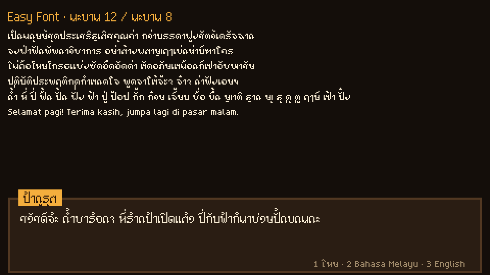
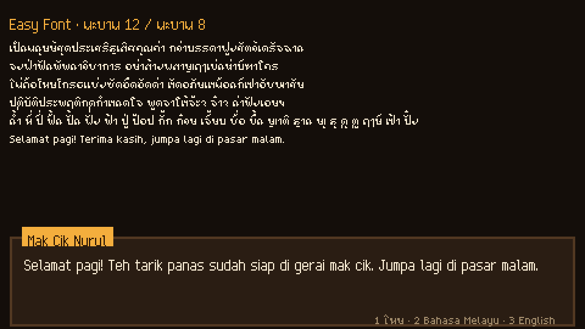
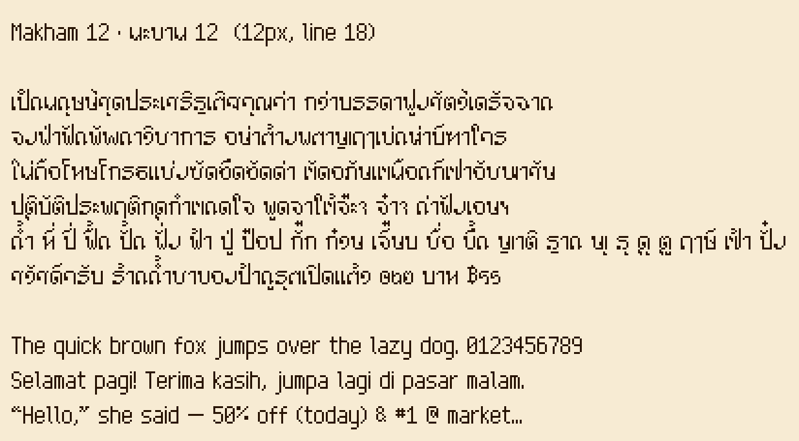
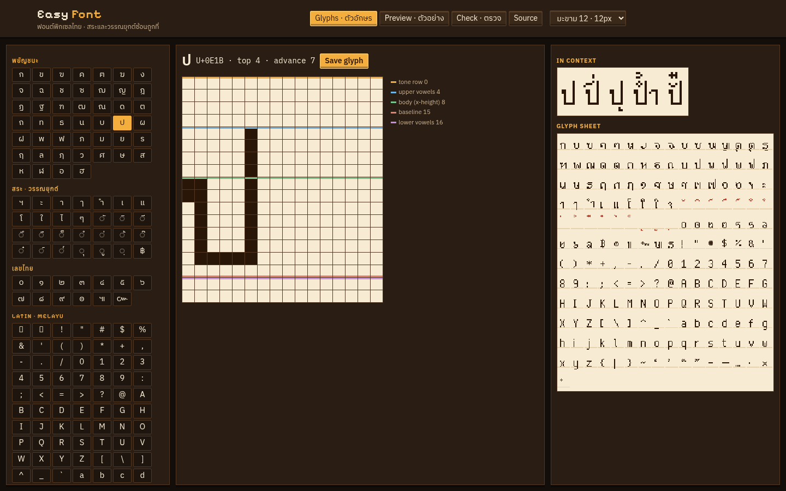

<!-- easy-suite:header:start -->
<!-- easy-suite:header:end -->

# Easy Font

**ฟอนต์พิกเซลไทย มะขาม 12 และ มะขาม 8 · สระและวรรณยุกต์ซ้อนถูกที่ · ไทย Bahasa Melayu English**  
Two original pixel bitmap fonts for games — **มะขาม 12 (Makham 12)** for dialogue and **มะขาม 8 (Makham 8)** for UI
labels — that cover every Thai character, Latin (English and Malay) and common punctuation, with **correct Thai
stacking**: tone marks drop when there is no upper vowel (ก่) and sit above one when there is (กี่), marks move left
over ป ฝ ฟ ฬ, ญ ฐ lose their tails over ุ ู, and ำ goes under the tone mark (น้ำ). Draw glyphs as `#`/`.` text
(`easyfont/1`), check them, and export **BMFont `.fnt` + PNG**, a **Godot 4.3+ FontFile** project with an `EasyFont`
autoload, and a **PixiJS v8 BitmapFont** runtime. CLI, web editor and MCP server; local only, no network.

<p align="center"></p>

| Godot 4.3 `EasyFont` demo (Thai) | PixiJS v8 BitmapText demo (Malay) |
|---|---|
|  |  |

## The fonts

| Font | Size | Cell | Use | Glyphs |
|---|---|---|---|---|
| `makham-12` · มะขาม 12 | 12 px | 18 rows, baseline 15 | dialogue, titles | 193 drawn + 41 generated Thai presentation forms |
| `makham-8` · มะขาม 8 | 8 px | 15 rows, baseline 12 | HUD, menus, item counts | 193 drawn + 41 generated |

<p align="center"></p>
<p align="center"></p>

Both are drawn from scratch for Easy Suite (loopless Thai, 2×2 heads, square Latin) — not traced from any font —
and released under the **SIL Open Font License 1.1** with no Reserved Font Name, so you can ship, modify and rename
them. The code is MIT.

## Quick start

```bash
npm install
npx tsx src/cli.ts init --workspace ~/my-fonts          # fonts/makham-12.easyfont, fonts/makham-8.easyfont, OFL.txt
npx tsx src/cli.ts check --workspace ~/my-fonts         # coverage + stacking on every sample sentence
npx tsx src/cli.ts render "น้ำชา ปี่ ฟื้น\nSelamat pagi" --out shot.png --scale 4 --workspace ~/my-fonts
npx tsx src/cli.ts export --workspace ~/my-fonts        # exports/easyfont-{bmfont,godot,pixi,png}/
npx tsx src/cli.ts serve --workspace ~/my-fonts         # web editor on http://127.0.0.1:8948
```

Other commands: `info`, `list [font] [--marks]`, `show <char>`, `set-glyph <char> <rows> --top N [--mark]`,
`shape <text>` (prints the presentation forms an engine draws).

## How Thai stacking works

Bitmap engines (BMFont readers, Godot `FontFile`, Pixi `BitmapText`) place one glyph after another, so the stacking
is decided before drawing. `shapeThai()` (TypeScript, with a line-for-line GDScript port, parity-tested) turns every
combining mark into a Private Use Area presentation form that already sits at the right height and column:

| Case | Example | Form |
|---|---|---|
| tone mark, no upper vowel | ก่ ก้ | low tone U+F70A–F70E (drops by `lowshift`) |
| tone mark over an upper vowel | กี่ กั๊ | high tone U+F726–F72A |
| tall letters ป ฝ ฟ ฬ | ปี่ ฟื้น ป่ | left forms U+F701–F717 (move by `leftshift`) |
| ญ ฐ + lower vowel | ญุ ฐู | hand-drawn tailless U+F70F / U+F700 |
| ฎ ฏ + lower vowel | ฎุ ฏู | U+F718–F71A (drop by `lowerdrop`) |
| sara am | น้ำ ป่ำ | ํ + tone + า (nikhahit under the tone) |

U+F700–F71A follow the common Thai PUA convention; U+F720–F72F are Easy Font's normal-position copies so engines that
group combining marks into graphemes still draw each mark. Forms are generated from the drawn marks (draw one to
override). `check` lays out the Thai sample poem and hard clusters and reports any mark that overlaps, touches,
floats away from or clips above its letter.

## Source format (`easyfont/1`)

```text
format easyfont/1
id makham-12
name Makham 12
th มะขาม 12
size 12
line 18          # cell height
baseline 15
spacing 1
space 4
zones tone=0 upper=4 body=8 lower=16 lowshift=4 leftshift=2 lowerdrop=0

g ก 8            # character (or U+XXXX), top row
.####.
##...#
#....#

g U+0E48 0 mark  # zero width, right-aligned over the previous letter
#
#
```

Full reference: [docs/FORMAT.md](docs/FORMAT.md).

## Export

| Preset | Output |
|---|---|
| `bmfont` | `<id>.fnt` (AngelCode text) + `<id>.png` (white ink, tint it) + `fonts.json` + `OFL.txt` — Godot, Pixi, Phaser, LibGDX, Love2D… |
| `godot` | Godot 4.3+ project: `easyfont/<id>.fnt` (imports as `FontFile`), `<id>.theme.tres`, `EasyFont` autoload (`shape`, `font`, `apply`, `measure`, `wrap`, `theme`), `EasyThaiShaper`, demo scene, `test_font.gd` |
| `pixi` | `loadEasyFonts(PIXI, "fonts/fonts.json")` → `text(str, {font, fill, scale, wrap})`, `shape`, `measure`, `wrap`; demo `index.html` |
| `png` | specimens, glyph sheets and dialogue-box previews |

```gdscript
# Godot: always shape Thai text (apply() does it), turn Label autowrap off and wrap with EasyFont
EasyFont.apply($Name, "ป้านูรุล", "makham-12", Color("#2a1606"))
$Body.text = EasyFont.wrap("สวัสดีจ้ะ น้ำชาร้อนๆ ที่ร้านป้าเปิดแล้ว", "makham-12", 440)
```

Line breaks: Thai has no spaces between words, so put U+200B (zero-width space) where a line may break; `wrap()`
breaks at spaces and U+200B in the CLI, Godot and Pixi alike.

**With the other Easy tools:** Easy Dialogue boxes and Easy UI panels call `EasyFont.shape()` when the autoload is
present (set `easyfont/<id>.theme.tres` as the font of the Easy UI teak theme); Easy Battle damage numbers and menus
read well in มะขาม 8.

## Web editor

`serve` opens a glyph editor: every glyph grouped (consonants, vowels and tone marks, Thai digits, Latin, tailless
forms), a pixel grid with the tone / upper / body / baseline / lower guide rows, the glyph in context (ปี่ ป้ำ ปุ…),
a live preview with a dialogue-box mode, the stacking check and the source text.

<p align="center"></p>

## MCP server

`npm run mcp` (stdio) or `npm run mcp:http` (port 8949). Tools: `workspace_info`, `list_glyphs`, `get_glyph`,
`set_glyph` (validates, `dryRun`), `write_font`, `check_font`, `shape_text`, `render_text` (returns a PNG) and
`export_fonts`. See [docs/MCP.md](docs/MCP.md).

## Ports

| | Port |
|---|---|
| Web editor / API | 8948 |
| MCP Streamable HTTP | 8949 |
| Vite dev UI | 5194 |

Everything binds to 127.0.0.1; a non-loopback `--host` needs the printed token.

## Development

```bash
npm test                                                 # vitest
GODOT=/path/to/godot npx vitest run test/godot.test.ts   # headless Godot: shaper parity, FontFile metrics, demo scene
npm run typecheck
npm run smoke                                            # CLI + MCP (stdio and HTTP)
npm run check:pixi -- exports/easyfont-pixi shot         # headless Chrome: fonts load, Thai shaped, text wraps
node scripts/build-core.mjs                              # after editing src/shared/shape.ts
```

<!-- easy-suite:table:start -->
<!-- easy-suite:table:end -->

## Credits

มะขาม 12 and มะขาม 8 are original designs, © 2026 Salahuddin Benno and the Easy Suite contributors, SIL OFL 1.1
(`samples/OFL.txt`). See [CREDITS.md](CREDITS.md). Code: MIT.
